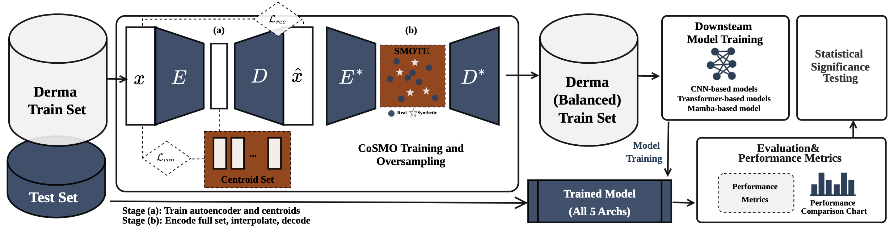

# CoSMO: From Rare to Recognized

**Contrastive Latent Oversampling for Minority Skin Lesion Classification**

[](https://www.python.org/)
[](https://pytorch.org/)

Code for **CoSMO**, a two-stage framework for imbalanced dermatological image classification.
*Paper under review at Biomedical Signal Processing and Control (revised version).*

---

## Overview

1. **Stage 1, structured latent space.** A class-centroid convolutional autoencoder with U-Net-style
   skip connections is trained with `L_total = α·L_rec + (1−α)·L_con`, where `L_con` is a
   self-contrastive centroid loss (α = 0.5).
2. **Stage 2, latent SMOTE.** Minority-class latents are interpolated with SMOTE (k = 5), decoded
   with skip features borrowed from the nearest real neighbour, and the balanced set is used to
   train downstream classifiers.

<p align="center">
  
</p>

---

## Results (DermaMNIST, 5-fold CV, mean ± std)

All conditions use identical classifier settings (AdamW, lr 1e-4, weight decay 1e-2,
label smoothing 0.1). Five architectures are trained from scratch; CoSMO uses the
latent dimension `n_z` shown.

| Model | Condition | ACC | AUC | Macro F1 | G-mean |
|---|---|---|---|---|---|
| ResNet-18 (n_z=128) | CoSMO | 0.7691 ± 0.0136 | 0.9060 ± 0.0118 | **0.5975 ± 0.0416** | **0.5509 ± 0.0371** |
| | Aug-only | **0.7869 ± 0.0064** | **0.9293 ± 0.0044** | 0.5856 ± 0.0311 | 0.4986 ± 0.0753 |
| | Imb-noaug | 0.7358 ± 0.0160 | 0.8915 ± 0.0169 | 0.4577 ± 0.0187 | 0.2171 ± 0.2010 |
| MobileNet-V2 (n_z=512) | CoSMO | 0.7504 ± 0.0108 | 0.8922 ± 0.0080 | **0.5499 ± 0.0190** | **0.5130 ± 0.0332** |
| | Aug-only | **0.7544 ± 0.0110** | **0.9121 ± 0.0083** | 0.4641 ± 0.0302 | 0.2683 ± 0.1543 |
| | Imb-noaug | 0.6829 ± 0.0061 | 0.8190 ± 0.0087 | 0.2811 ± 0.0155 | 0.0000 ± 0.0000 |
| EfficientNet-B0 (n_z=512) | CoSMO | 0.7592 ± 0.0184 | 0.8827 ± 0.0144 | **0.5992 ± 0.0274** | **0.5788 ± 0.0373** |
| | Aug-only | **0.7810 ± 0.0086** | **0.9238 ± 0.0107** | 0.5505 ± 0.0219 | 0.4611 ± 0.0463 |
| | Imb-noaug | 0.7086 ± 0.0102 | 0.8403 ± 0.0138 | 0.3579 ± 0.0346 | 0.0494 ± 0.1105 |
| ViT (n_z=128) | CoSMO | 0.7157 ± 0.0291 | 0.8482 ± 0.0096 | **0.4974 ± 0.0320** | **0.4574 ± 0.0304** |
| | Aug-only | **0.7348 ± 0.0087** | **0.8937 ± 0.0099** | 0.4543 ± 0.0278 | 0.3022 ± 0.1709 |
| | Imb-noaug | 0.6910 ± 0.0177 | 0.8584 ± 0.0119 | 0.4060 ± 0.0205 | 0.1916 ± 0.1767 |
| Vim (n_z=512) | CoSMO | 0.7319 ± 0.0138 | 0.8422 ± 0.0209 | 0.5273 ± 0.0255 | **0.4914 ± 0.0251** |
| | Aug-only | **0.7645 ± 0.0067** | **0.9123 ± 0.0012** | **0.5386 ± 0.0280** | 0.4712 ± 0.0393 |
| | Imb-noaug | 0.7162 ± 0.0117 | 0.8360 ± 0.0232 | 0.4428 ± 0.0184 | 0.2966 ± 0.1700 |
| *Vim, ImageNet-pretrained (reference)* | CoSMO | 0.8629 ± 0.0159 | 0.9383 ± 0.0076 | **0.7744 ± 0.0213** | 0.7382 ± 0.0296 |
| | Aug-only | **0.8689 ± 0.0088** | **0.9535 ± 0.0069** | 0.7676 ± 0.0169 | **0.7425 ± 0.0163** |
| | Imb-noaug | 0.8270 ± 0.0087 | 0.9274 ± 0.0120 | 0.6920 ± 0.0169 | 0.6540 ± 0.0302 |

**Statistics.** Lesion-level cluster bootstrap (2,000 resamples of lesions, pooled out-of-fold
predictions) with Holm correction, applied separately to macro F1 and G-mean (15 comparisons for
the from-scratch models, 3 for the reference row). After correction:

- CoSMO improves macro F1 and G-mean over **Imb-noaug** for all five architectures.
- Over **Aug-only**, both improve significantly for EfficientNet-B0, MobileNet-V2 and ViT, but not
  for ResNet-18 or Vim.
- CoSMO has **lower AUC and accuracy than Aug-only** for every architecture.
- Over **AE+SMOTE** (same pipeline without `L_con`), G-mean improves significantly for four of five
  architectures; for ResNet-18 the contrastive loss lowers G-mean.

---

## Repository structure

```
prepare_folds.py               # 5-fold stratified splits -> data/prepared/
run_sampling.py                # Stage 1: autoencoder + latent SMOTE -> outputs/balanced*/
run_classification.py          # Stage 2: classifiers, all conditions -> outputs/ablation*/
Derma_CoSMO_modified.py        # CoSMO model, losses, run_cosmo_resampling()
Derma_classification_lowmem.py # classifier training / evaluation loop
vim_model_timm.py              # timm backbone wrapper used by the classification loop
vim_real/                      # official Vision Mamba (hustvl/Vim) wrapper + env install script
analysis/
  analyze_ablation.py          # bootstrap CIs + Holm, per-class metrics, unseen-lesion results
  make_pr_threshold.py         # precision-recall curves and threshold analysis (EfficientNet-B0)
  r22_synthetic_checks.py      # validity checks of synthetic images (label consistency, nearest neighbour)
data/metadata/                 # HAM10000 lesion IDs for the lesion-level bootstrap (see below)
```

---

## Requirements

```bash
pip install -r requirements.txt
```

Vision Mamba needs its own environment with compiled CUDA kernels:
`bash vim_real/install_vim_env.sh` (creates the conda env `vimreal`, clones
[hustvl/Vim](https://github.com/hustvl/Vim) and downloads Vim-tiny weights into `vim_real/weights/`).

---

## Reproducing the paper

```bash
# 0. data: 5 folds (StratifiedKFold, random_state=42), 90/10 train/val inside each fold
python prepare_folds.py

# 1. Stage 1: CoSMO (alpha=0.5) and the AE+SMOTE ablation (alpha=1.0, no contrastive loss)
python run_sampling.py --n_z 128 512
python run_sampling.py --n_z 128 512 --alpha 1.0 --out_dir ./outputs/balanced_ae_smote

# 2. Stage 2: classifiers (identical settings for every condition)
python run_classification.py --conditions imb_noaug aug_only ae_smote cosmo \
    --models resnet18 efficientnet_b0 mobilenet_v2 vit
python run_classification.py --conditions imb_noaug aug_only ae_smote cosmo \
    --models vim_real --vim-scratch          # Vim from scratch (vimreal env)
python run_classification.py --conditions imb_noaug aug_only ae_smote cosmo \
    --models vim_real                        # ImageNet-pretrained Vim (reference)

# 3. statistics and figures -> analysis/results/
python analysis/analyze_ablation.py
python analysis/make_pr_threshold.py
python analysis/r22_synthetic_checks.py
```

Latent-dimension sweep (Section 5.9): `run_sampling.py --n_z 64 128 256 512`, then
`run_classification.py --conditions cosmo --sweep-nz <N>`. The results CSV also stores
the validation macro F1 (`val_F1`) so `n_z` can be selected without the test folds.

The analysis scripts read DermaMNIST labels from `~/.medmnist/dermamnist.npz`
(`python -c "from medmnist import DermaMNIST; DermaMNIST(split='train', download=True)"`).

### Lesion-level metadata

`data/metadata/` maps DermaMNIST indices to HAM10000 `image_id` and `lesion_id`. It is derived from
the HAM10000 metadata (Tschandl et al., 2018, CC BY-NC 4.0) and is used only to group test images by
lesion in the bootstrap and to identify unseen-lesion test images. The folds themselves are split by
image, not by lesion, as in the paper.

---

## Key hyperparameters

| Parameter | Value |
|---|---|
| `n_z` | 128 (ResNet-18, ViT), 512 (others); sweep {64, 128, 256, 512} |
| `alpha` | 0.5 (CoSMO), 1.0 (AE+SMOTE) |
| `temperature` | 0.07 |
| autoencoder | lr 2e-4, weight decay 5e-4, 200 epochs, batch 32, `dim_h` 128 |
| classifiers | AdamW, lr 1e-4, weight decay 1e-2, label smoothing 0.1, ReduceLROnPlateau (factor 0.5, patience 5), effective batch 256 via gradient accumulation, max 100 epochs, early stopping on validation macro F1 (patience 30) |
| SMOTE | k = 5 |

---

## Citation

```bibtex
@article{cosmo2026,
  title   = {From Rare to Recognized: Contrastive Latent Oversampling
             for Minority Skin Lesion Classification},
  author  = {Homjandee, Suvaporn and Sinapiromsaran, Krung
             and Kertkeidkachorn, Natthawut},
  journal = {Under review},
  year    = {2026}
}
```

---

## Acknowledgements

The first author is supported by the Royal Thai Government's DPST Scholarship. Computational
resources were provided by the Department of Mathematics and Computer Science, Chulalongkorn
University, and the Knowledge Laboratory (KnOWLab) at JAIST.
